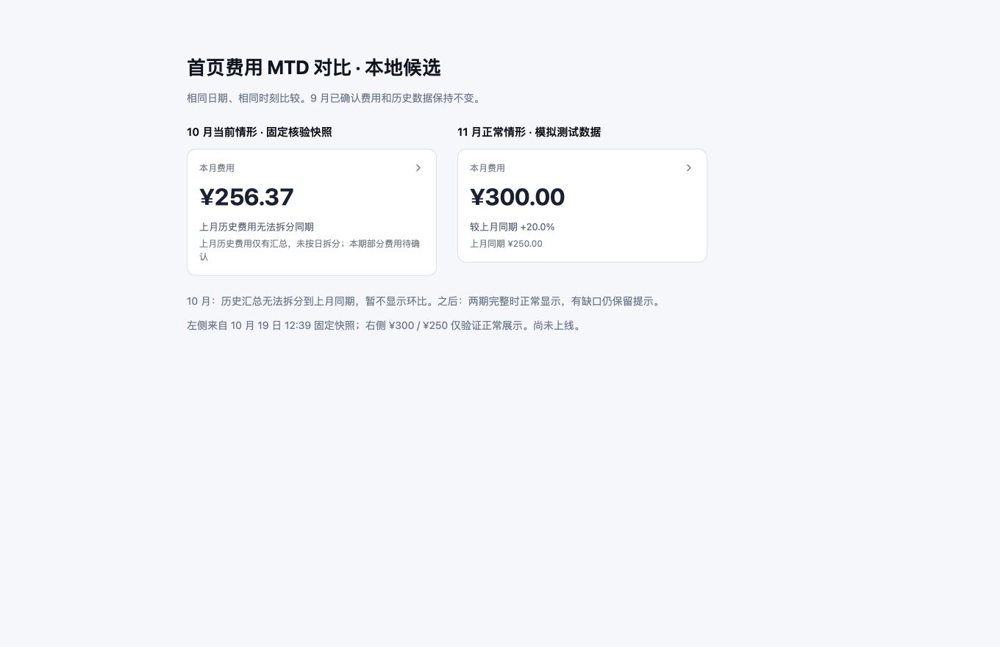

# 首页费用 MTD 展示最终候选

本文件记录本地实现与验证结果；提交、推送和合并状态以 Git 引用及本次操作回执为准。生产尚未部署本候选。基线为 `574374acc13649679e43c86778a9e050741e2e31`。本稿以用户最新确认的“9 月费用不再核改；10 月历史同期不可比时给出说明；11 月正常按 MTD 比较”为准。

## 最终行为

- 本期和上期用同一个只读费用查询，分别截止到本月和上月相同日期、相同时刻。上月没有对应日时沿用既有月末截断规则。
- 新增可选 `monthlyCost.mtdComparison` 契约；原月度账单字段和所有完整性状态保留。旧后端未提供新契约时沿用原规则。
- 上期存在历史金额未迁移、无法支持同期拆分时，显示“上月历史费用无法拆分同期”，脚注说明“上月历史费用仅有汇总，未按日拆分”。不把仅含套餐的 199 元当作完整上期总额展示，不显示 +28.8%。
- 双期完整、同币种且上期金额大于零时，显示正常 MTD 环比，不加“（已记录费用）”。例如 11 月 1–19 日对比 10 月 1–19 日。
- 本期或上期仍有未知费用、现金金额缺失或币种缺口时，继续显示“费用尚未完整，暂不显示环比”；不因日期到了 11 月而强行解除。
- 上期零、负值、无可比金额或多币种继续保持不可比说明。

9 月原账、费用金额、历史关联、40.4572 元汇总事件与本月会计处置均不修改。历史汇总不提前计入，也不按天或 Token 均摊。本候选无数据库迁移、无数据修复调用、无生产写操作。

## 组件预览

左侧来自 2026-10-19 12:39 已保存费用快照，本期显示 256.37 元并解释上月不可比。右侧是 11 月完整双期的模拟用例，300 元对比 250 元，正常显示 +20.0%；右侧不是未来真实费用。

本地临时预览地址：<http://127.0.0.1:5186/mtd-preview.html>（不作为产品入口提交）。百分比旁的“（已记录费用）”已按用户要求移除。

## 验证结果

109 项不同用例通过：前端展示模型及页面 65 项、标准首页数据库集成 15 项、首页/费用纯函数 17 项、财务区间完整性回归 12 项。

关键用例覆盖：相同截止时刻的排他边界；未来日期费用不进入本期 MTD；查询前后账本逐行不变；费用查询可在只读事务运行；10 月历史汇总不显示比例；11 月完整数据正常比较；11 月存在本期或上期缺口仍阻断百分比。

Database、Control API、Web 类型检查通过；变更文件 lint、Web 构建、git diff --check 通过。Web 构建仍有既有大 chunk 提示。

## 发布边界

线上尚未更新为本候选。发布需配套 Control API 和 Web，保留 Gateway、企微 Worker 和数据库。当前生产 Web 与候选主线基线之间另有前端批次，不能未经核对直接发布整个 main；应基于实际生产 Web 版本仅应用本次展示与契约差异，并重新验证构建。

旧历史关联任务保持暂停。本候选不恢复该任务，也不执行其关联迁移。源文件指纹及候选状态见 [candidate.json](./candidate.json)。
